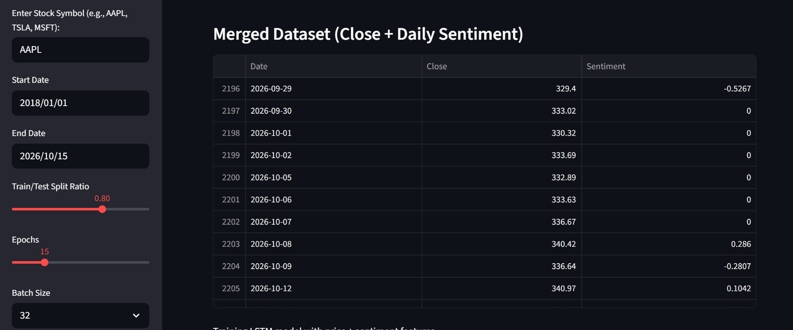
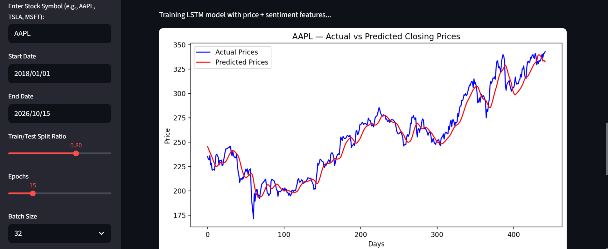
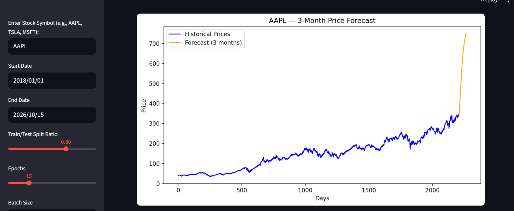
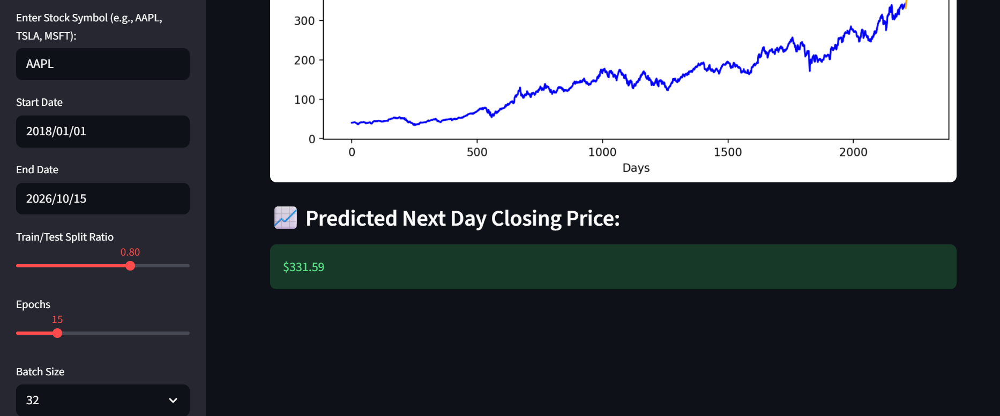

# 📈 AI Stock Price Prediction with News Sentiment (LSTM & Streamlit)

Application web interactive de Deep Learning développée en Python qui combine l'analyse des **tendances boursières historiques** (via Yahoo Finance) et **l'analyse de sentiment des actualités financières** (via NLTK/VADER) pour prédire les cours boursiers à l'aide d'un réseau de neurones récurrents (**LSTM**).

## 🚀 Fonctionnalités Clés
* **Double Source de Données (Multimodal) :** Intégration automatique des prix de clôture et du score de sentiment des actualités financières en temps réel pour affiner la modélisation.
* **Architecture LSTM Profonde :** Réseau séquentiel multi-couches avec régularisation (`Dropout`) pour l'apprentissage des séries temporelles financières.
* **Prévision Future (3 Mois) :** Simulation et projection des tendances boursières à moyen terme.
* **Interface Interactive (Streamlit) :** Permet une configuration dynamique (choix de l'action, des dates, des époques d'entraînement et de la taille des batchs).

## 🛠️ Stack Technique
* **Langage :** Python
* **Interface Web :** Streamlit
* **Deep Learning :** TensorFlow, Keras
* **NLP & Sentiment :** NLTK (VADER), Feedparser, Finvizfinance
* **Data Science & API :** Pandas, NumPy, Scikit-Learn, yfinance
* **Visualisation :** Matplotlib

## 📊 Aperçu de l'Application

**1. Analyse du sentiment des actualités financières en temps réel :**


**2. Fusion des données (Cours + Sentiment) :**


**3. Évaluation du modèle (Prix Réels vs Prédits) :**


**4. Projection boursière sur 3 mois :**


**5. Estimation du cours pour le jour suivant :**


## ⚙️ Comment lancer l'application en local ?

1. Clonez ou téléchargez ce dépôt.
2. Installez les dépendances requises :
   ```bash
   pip install -r requirements.txt
